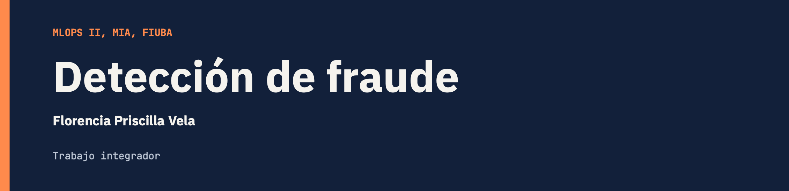
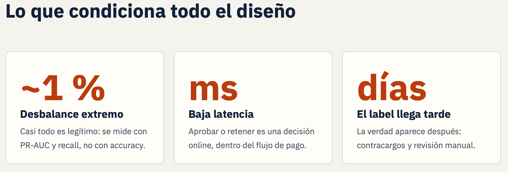
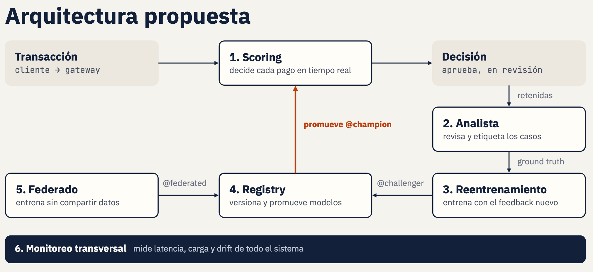
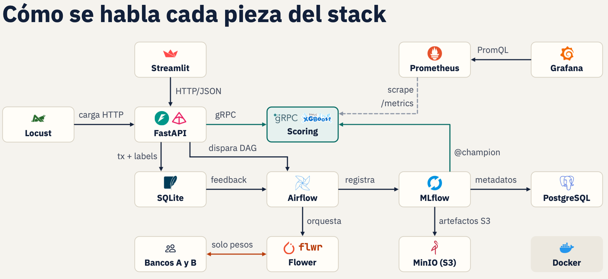

# fraud-detection




Sistema de **detección de fraude con tarjeta** (XGBoost, dataset `pointe77/credit-card-transaction`) construido alrededor de un **despliegue seguro de modelos**: un **champion** decide (aprobar / retener) y **dos modelos en sombra** —un **challenger** (XGBoost) y un **modelo federado** (MLP entrenado con Flower sobre silos de varios bancos, sin compartir datos)— predicen sin decidir; cuando llega la *ground truth* se comparan y, si una sombra mejora, se promueve a champion con un deploy explícito.

El stack integra el ciclo MLOps completo: **Airflow** orquesta el reentrenamiento, **MLflow** versiona los modelos, **MinIO** es el **data lake** (datos crudos/procesados + artefactos de modelos) y **Prometheus/Grafana + Evidently** dan observabilidad (latencia y drift). Encima corre una **capa de seguridad** basada en el framework **SAIF** (clase 7): API keys con **roles** (analyst / mlops / admin), **rate limiting**, **auditoría**, **hash de integridad** del modelo, **autenticación en el núcleo gRPC**, **secretos en** `.env` y **defensas del federado** contra envenenamiento (clipping + agregación robusta + privacidad diferencial).

- Arquitectura y diagramas (casos de uso, secuencia, arquitectura): `[proposed-architecture/](proposed-architecture/)`.
- Trabajos prácticos de la cursada (REST/GraphQL/gRPC y streaming), **standalone**: `[TPs/](TPs/)`.







---


## Setup

```bash
python3 -m venv .venv
./.venv/bin/pip install -r requirements.txt
```

> Python recomendado: **3.11 / 3.12** (es donde hay wheels estables de xgboost/scikit-learn).

El contrato del modelo es `models/model.joblib`: un dict con `pipeline` (sklearn: OneHot + XGBoost), `feature_order`, `metrics`, `version`, etc. Lo genera el pipeline de datos (abajo) y lo sirve el núcleo.

---


## Cómo correr

Hay dos formas: **(A) todo el sistema integrado con Docker** o **(B) componente por componente en local**.

### A) Sistema integrado (Docker Compose)

Levanta la pila completa (Airflow + MLflow + PostgreSQL + MinIO + núcleo gRPC + REST + UI + Prometheus/Grafana). El `airflow-init` migra la DB, crea el usuario admin y **siembra el primer champion**.

**Secretos (SAIF capa 4):** las credenciales (API keys, Postgres, MinIO, Grafana, Airflow) salen de variables de entorno con defaults seguros para la demo. Para personalizarlas, copiá la plantilla: `cp .env.example .env` (el `.env` está en `.gitignore`, nunca se versiona). Sin `.env` el stack igual levanta con los defaults.

```bash
docker compose up -d --build

# capas opt-in (dependen de datos que genera Airflow en runtime):
docker compose --profile federated up -d      # Aprendizaje Federado (Flower + 2 bancos)
docker compose --profile monitoring up -d     # Evidently (drift)
docker compose --profile loadtest up -d       # Locust (prueba de carga, :8089)
docker compose --profile full up -d --build   # todo junto (recomendado para la demo)
```


| Servicio                               | URL                                                      | Credenciales                          |
| -------------------------------------- | -------------------------------------------------------- | ------------------------------------- |
| **REST** (API del sistema)             | [http://localhost:8080/docs](http://localhost:8080/docs) | header `X-API-KEY: token-secreto-123` |
| **UI** del analista (Streamlit)        | [http://localhost:8501](http://localhost:8501)           | —                                     |
| **núcleo gRPC**                        | `localhost:50052`                                        | —                                     |
| **MLflow** (tracking + registry)       | [http://localhost:5001](http://localhost:5001)           | —                                     |
| **Airflow** (DAGs / retrain)           | [http://localhost:8081](http://localhost:8081)           | `admin` / `admin`                     |
| **MinIO** (data lake)                  | [http://localhost:9001](http://localhost:9001)           | `minioadmin` / `minioadmin`           |
| **Prometheus**                         | [http://localhost:9090](http://localhost:9090)           | —                                     |
| **Grafana**                            | [http://localhost:3000](http://localhost:3000)           | `admin` / `admin`                     |
| **Locust** (carga, profile `loadtest`) | [http://localhost:8089](http://localhost:8089)           | —                                     |


En Airflow hay dos DAGs: `fraud_pipeline` (reentrenamiento centralizado → `@challenger`) y `fraud_federate_pipeline` (orquesta el entrenamiento federado y registra el modelo global como `@federated`). El federado requiere construir su imagen una vez (`docker compose --profile federated build`).

```bash
# Bajá SIEMPRE con el mismo --profile del `up` (si no, los servicios de perfil —loadtest,
# fed-*, evidently— quedan colgados y la red no se libera: "Resource is still in use").
docker compose --profile full down --remove-orphans       # frenar todo
docker compose --profile full down -v --remove-orphans    # + borrar volúmenes (de cero)
rm -f data/fraud.db                                        # fraud.db es bind mount; -v no lo borra
```


### B) Por componentes (local, sin Docker)

**1. Pipeline datos → modelo** (deja `models/model.joblib`):

```bash
./.venv/bin/python -m fraud.dataset      # ingesta (muestra ~1% fraude) -> data/raw/
./.venv/bin/python -m fraud.features     # features + split estratificado -> data/processed/
./.venv/bin/python -m fraud.modeling.train   # entrena (rebalanceo solo en train) -> models/model.joblib
```

> **Data lake:** en el stack integrado, `dataset`/`features` además **suben** el raw y los
> procesados a MinIO (bucket `data-lake`, capas `raw/` y `processed/`) vía `fraud/datalake.py`,
> y `features` **lee el raw del lake**. Así el entrenamiento consume del data lake y no de
> HuggingFace. En local sin MinIO es un no-op (sigue con los archivos de `data/`).

`train.py` está **parametrizado** (sin artefactos mágicos): el modelo productivo y el champion malo de la demo salen del mismo código.

```bash
# modelo productivo (default): 300 árboles, balanceado -> v1.0.0
./.venv/bin/python -m fraud.modeling.train

# champion inicial "malo" para la demo: pocas iteraciones + sin balanceo
./.venv/bin/python -m fraud.modeling.train --no-balance --n-estimators 5 --max-depth 3 \
  --version 0.1.0-pocas-iteraciones --output models/badmodel.joblib
```

**2. API REST** (borde: analista + MLOps; también `/v1/predict`):

```bash
./.venv/bin/uvicorn fraud.api.main:app --reload --port 8080
# Swagger: http://localhost:8080/docs
```

**3. Núcleo gRPC + REST delegando** (dos terminales):

```bash
# terminal 1: núcleo de scoring
./.venv/bin/python -m fraud.api.grpc_server          # escucha en localhost:50052

# terminal 2: REST delegando el scoring del champion en el núcleo gRPC
GRPC_HOST=localhost GRPC_PORT=50052 ./.venv/bin/uvicorn fraud.api.main:app --port 8080
```

**4. Activar un challenger en sombra** (para ver el doble scoring en local):

```bash
cp models/model.joblib models/challenger.joblib   # un challenger de juguete (copia del champion)
# reiniciá la REST: ahora /v1/predict devuelve también el score del challenger
```

**5. UI del analista** (consume la REST):

```bash
REST_URL=http://localhost:8080 API_KEY=token-secreto-123 \
  ./.venv/bin/streamlit run services/ui/app.py       # http://localhost:8501
```

---


## Cómo probarlo


### Tests automáticos

```bash
make test                      # == ./.venv/bin/python -m pytest tests
./.venv/bin/python -m pytest tests -q
```

Cubren: la API y el flujo champion/challenger de punta a punta (`test_champion_challenger.py`: predict con sombra → revisión → decisión → post-mortem → evaluación → deploy), la **seguridad** (`test_security.py`: roles/RBAC, hash, model card, auditoría), la **auth del núcleo gRPC** (`test_grpc_auth.py`) y las **defensas del federado** (`test_federated_robust.py`: la mediana resiste al cliente malicioso).

### Prueba manual del flujo (con la REST corriendo)

> Tip: para ver transacciones **retenidas** sin buscar una “de fraude”, arrancá la REST con `FRAUD_REVIEW_THRESHOLD=0.0` (todo lo >0 va a revisión). Y asegurate de tener `models/challenger.joblib` (paso B4) para ver el challenger en sombra.

```bash
KEY='X-API-KEY: token-secreto-123'
JSON='Content-Type: application/json'
TX='{"amt":980.5,"category":"shopping_net","gender":"M","city_pop":12000,"lat":40.71,"long":-74.0,"merch_lat":34.05,"merch_long":-118.24,"hour":3,"age":27}'

# 1) Scoring: el champion decide, el challenger (si hay) va en sombra
curl -s -XPOST localhost:8080/v1/predict -H "$KEY" -H "$JSON" -d "$TX"
#   -> { "is_fraud":..., "decision":"review|approve", "status":"PENDING|OK",
#        "transaction_id":"tx-...", "challenger": {...} }

# 2) Cola de revisión del analista
curl -s localhost:8080/v1/reviews -H "$KEY"

# 3) Resolver una tx (genera ground truth). approve=legítima(0) · reject=fraude(1)
curl -s -XPOST localhost:8080/v1/transactions/<TX_ID>/decision -H "$KEY" -H "$JSON" -d '{"decision":"reject"}'

# 4) Denuncia post-mortem (label tardío de fraude)
curl -s -XPOST localhost:8080/v1/transactions/<TX_ID>/report-fraud -H "$KEY"

# 5) Evaluar challenger vs champion contra la ground truth acumulada
curl -s -XPOST localhost:8080/v1/mlops/evaluate -H "$KEY"

# 6) Deploy: promover el challenger a champion (o revertir)
curl -s -XPOST 'localhost:8080/v1/mlops/deploy?action=promote'  -H "$KEY"
curl -s -XPOST 'localhost:8080/v1/mlops/deploy?action=rollback' -H "$KEY"
```

En el sistema integrado, el **retrain** se dispara desde Airflow ([http://localhost:8081](http://localhost:8081), DAG `fraud_pipeline`) o con `curl -XPOST .../v1/mlops/train`. El primer modelo queda como `champion`; **cada retrain posterior entra como** `challenger` y espera evaluación + deploy. El DAG `fraud_federate_pipeline` hace lo propio con el **modelo federado** (lo registra como `@federated`, segunda sombra promovible). Para promover la sombra que prefieras: `deploy?action=promote&source=challenger|federated`.

### Lint / formato

```bash
make lint      # ruff format --check + ruff check
make format    # autofix
```


### Prueba de carga (muchos clientes concurrentes)

Simulá tráfico real contra el borde REST y medí latencias con **Locust** (web UI):

```bash
docker compose --profile loadtest up -d        # levanta Locust
# abrí http://localhost:8089 -> elegí Nº de usuarios y "Start"
```

Cada usuario virtual envía transacciones **reales** del split de test a `/v1/predict`; la UI muestra **RPS, latencias p50/p95/p99 y tasa de error** en vivo, y el tráfico queda registrado en `fraud.db` (datos reales, consultables después). Config por env del servicio `loadtest` (`LOCUST_HOST`, `API_KEY`, `LOADTEST_DATA`) — nada hardcodeado en el código.

---


## Endpoints de la API REST


| Método · ruta                                                               | Rol            | Qué hace                                                                        |
| --------------------------------------------------------------------------- | -------------- | ------------------------------------------------------------------------------- |
| `GET /health`                                                               | infra          | estado + versión (público)                                                      |
| `POST /v1/predict`                                                          | cliente        | scoring: champion decide + challenger y federado en sombra; registra la tx      |
| `GET /v1/model-info`                                                        | analista/mlops | metadatos del champion servido (incluye categorías + hash de integridad)        |
| `GET /v1/model-card`                                                        | analista/mlops | model card de gobernanza (versión, hash, métricas, controles)                   |
| `GET /v1/reviews?status=PENDING`                                            | analista       | cola de transacciones retenidas                                                 |
| `GET /v1/transactions/{id}`                                                 | analista       | detalle (raw + scores champion/challenger/federado + label)                     |
| `POST /v1/transactions/{id}/decision`                                       | analista       | resuelve: `approve` / `reject` (guarda label)                                   |
| `POST /v1/transactions/{id}/report-fraud`                                   | post-mortem    | label tardío de fraude                                                          |
| `POST /v1/mlops/seed-frauds?n=30`                                           | MLOps          | siembra ground truth muestreando fraudes **reales** del dataset                 |
| `POST /v1/mlops/evaluate`                                                   | MLOps          | compara challenger y federado vs champion (ground truth)                        |
| `POST /v1/mlops/compare-federated`                                          | MLOps          | benchmark offline sobre el test: federado vs centralizado (% PR-AUC recuperado) |
| `POST /v1/mlops/deploy?action=promote|rollback&source=challenger|federated` | MLOps          | promueve la sombra elegida a champion / revierte                                |
| `POST /v1/mlops/reload`                                                     | MLOps          | recarga champion + sombras sin reiniciar (tras un retrain)                      |
| `POST /v1/mlops/train`                                                      | MLOps          | dispara el retrain (DAG de Airflow)                                             |
| `GET /v1/audit`                                                             | analista/mlops | últimos eventos del log de auditoría (SAIF capa 8)                              |
| `GET /metrics`                                                              | infra          | métricas Prometheus                                                             |


**Autenticación y roles (RBAC, SAIF capa 1):** todas (salvo `/health` y `/metrics`) requieren el header `X-API-KEY`. Hay tres roles, cada uno con su token por env:

- **admin** (`API_KEYS`, default `token-secreto-123`) — puede todo.
- **analyst** (`ANALYST_API_KEYS`, default `analyst-key`) — scoring + revisión; las acciones de MLOps le dan `403`.
- **mlops** (`MLOPS_API_KEYS`, default `mlops-key`) — entrenar / evaluar / desplegar.

Además: **rate limiting** por IP+key (`RATE_LIMIT`, slowapi), **auditoría** por evento (`logs/audit.log`), y el núcleo **gRPC** exige su propia key en la metadata (`GRPC_API_KEYS` / `GRPC_API_KEY`). La UI trae un **selector de rol** en el panel lateral para probar el RBAC en vivo.

---


## Seguridad (framework SAIF)

Controles de seguridad mapeados a las capas del framework **SAIF de Google** (clase 7), aplicados al sistema de fraude:


| Capa              | Control                                                                                     | Dónde                                |
| ----------------- | ------------------------------------------------------------------------------------------- | ------------------------------------ |
| 1 · AuthN/AuthZ   | API keys con **roles** (analyst/mlops/admin)                                                | `fraud/api/security.py`              |
| 1 · gRPC          | interceptor de `x-api-key` en el núcleo                                                     | `fraud/api/grpc_server.py`           |
| 2 · Validación    | entradas tipadas con Pydantic                                                               | `fraud/api/schemas.py`               |
| 3 · Rate limiting | slowapi por IP+key (`RATE_LIMIT`)                                                           | `fraud/api/security.py`              |
| 4 · Secretos      | `.env` (gitignored) + `.env.example`; nada hardcodeado                                      | `docker-compose.yml`, `.env.example` |
| 7 · Integridad    | **SHA-256** del artefacto servido (`/health`, `/v1/model-card`)                             | `fraud/api/model_loader.py`          |
| 8 · Gobernanza    | **model card** + **log de auditoría** por evento (`/v1/audit`)                              | `fraud/api/security.py`              |
| 5 · Entrenamiento | defensas del federado: **clipping + agregación robusta (mediana) + privacidad diferencial** | `services/federated/robust.py`       |


Las defensas del federado están gateadas por env en el servidor Flower (`FED_AGG`, `FED_CLIP_NORM`, `FED_DP_NOISE`; apagadas por defecto). Demo del ataque de envenenamiento (*label flipping*) y su mitigación, lado a lado:

```bash
docker compose run --rm fed-server python demo_poisoning.py --rounds 5 --sample 20000
# imprime 3 escenarios: limpio / atacado (cae el PR-AUC) / defendido (lo recupera)
```

La mayoría de los controles se ven desde la **UI → pestaña "Seguridad"** (roles/RBAC, hash, auditoría) y el **selector de rol** del panel lateral.

---


## Estructura del repo

```
fraud/                  # paquete principal (pipeline + serving del sistema)
  dataset.py features.py modeling/train.py   # datos -> modelo (train.py parametrizado)
  datalake.py                                # sube/baja datos al data lake (MinIO/S3)
  federated_model.py                         # adapter: envuelve el MLP federado tras interfaz sklearn
  api/
    grpc_server.py grpc_client.py            # núcleo de scoring (gRPC) + auth por metadata
    main.py schemas.py                       # borde REST (analista + MLOps)
    security.py                              # SAIF: roles/RBAC, rate limiting, auditoría
    model_loader.py                          # carga champion/challenger/federado (MLflow o local) + hash
    scoring.py store.py evaluation.py deploy.py   # sombras, store, evaluador, deploy
airflow/
  dags/                 # fraud_pipeline (central) + fraud_federate_pipeline (federado)
  scripts/              # register_model.py + register_federated.py + bootstrap_champion.py
services/
  federated/            # Aprendizaje Federado (Flower + MLP, bancos A/B)
    robust.py           #   defensas: clipping + agregación robusta + DP
    demo_poisoning.py   #   demo del ataque de envenenamiento y su mitigación
  monitoring/           # Evidently + Prometheus/Grafana
  loadtest/             # Locust (prueba de carga, web UI)
  ui/                   # Streamlit del analista (tabs: scoring, revisión, MLOps, modelo, seguridad)
docker/                 # Dockerfiles (api, grpc, mlflow, airflow)
docker-compose.yml      # sistema integrado (core + profiles federated/monitoring/loadtest/full)
.env.example            # plantilla de secretos (SAIF capa 4); el .env real va en .gitignore
proposed-architecture/  # diagramas + documento de arquitectura
TPs/                    # trabajos prácticos standalone de la cursada
tests/                  # tests del sistema (pytest: API, champion/challenger, seguridad, gRPC, federado)
```

---


## Trabajos prácticos (TPs)

Los mini-TPs de la cursada (REST, GraphQL+Neo4j, gRPC, streaming) viven **autocontenidos** en `[TPs/](TPs/)`, cada uno con su propio `docker-compose.yml` y README:

- `TPs/tp1-3-protocolos/` — comparación **REST vs GraphQL vs gRPC** sirviendo el mismo modelo + linaje Neo4j. `cd TPs/tp1-3-protocolos && docker compose up --build -d`
- `TPs/tp4-streaming/` — scoring **en streaming** (Redpanda/Kafka) con drift y alertas. `cd TPs/tp4-streaming && docker compose up --build -d`

Ver `[TPs/README.md](TPs/README.md)` para el detalle.